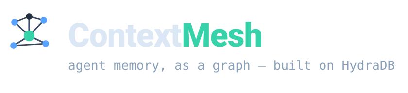

<p align="center">
  
</p>

# HydraContext / ContextMesh — agent context layer on HydraDB

**Hackathon build, Track 2.** Two layers, one graph DB:

- **HydraContext** — the agent context layer: an agent that starts with **zero
  tools loaded**, traverses [HydraDB](https://github.com/hydra-db/hydradb) to
  pull exactly the skills, tool schemas, MCP server definitions, and
  already-resolved entities a task needs.
- **ContextMesh** — the same layer packaged as a product endpoint
  (`hydracontext/service.py` + `site/index.html`) with a go-to-market story in
  [PITCH.md](PITCH.md).

HydraDB is the graph DB for everything: skills, tools, MCP servers, entities,
alias edges, sessions, and usage counters all live in SlateDB-backed object
storage, queried over its HTTP API with OpenCypher.

## The idea in one picture

```
User task
   │
   ▼
LangGraph agent
   │ ① store.plan(task)  ──► HydraDB graph (HTTP)
   │      keyword-match → Skill → NEEDS → Tool → SERVED_BY → MCPServer
   │      mentions → Alias → RESOLVES_TO → Entity   (batched OR-chain lookup)
   │ ② bind_tools(only the returned schemas)
   │ ③ entity mentions hit Entity nodes → no resolver round-trips at all
   │ ④ store.record_session(...)  ──► usage counters + new alias edges
   ▼
answer; the graph now knows more than it did before the task
```

Baseline agent (for comparison): every tool bound in the window, entity
resolution through a per-mention `lookup_entity` tool — the fan-out the
context layer eliminates.

## Repo layout

```
hydracontext/
  config.py       env-driven connection settings (HTTP API)
  store.py        HydraContextStore: schema-aware reads/writes + plan()
  seed_data.py    5 MCP servers, 15 tools, 6 skills, 9 entities, 10 aliases
  seed.py         bootstrap + seed CLI (--reset wipes known ids)
  demo.py         dry-run context pack demo (no LLM needed)
  service.py      ContextMesh FastAPI product API + website
  tools_sim.py    deterministic simulated MCP tool implementations
  agent/agent.py  LangGraph agents: mode="hydra" vs mode="baseline"
  eval/harness.py task suite + metrics + correctness scoring
bench/load.py    concurrent load harness (reads scale, writes serialized)
web/index.html   legacy demo UI (fallback if site/ is missing)
brand/           logo (SVG + PNG for X) + walkthrough video (narrated & silent)
scripts/render_brand_assets.py  X-ready logo renders: python -m scripts.render_brand_assets
scripts/render_video.py  regenerates the walkthrough: python -m scripts.render_video
scripts/add_audio.py     narration (edge-tts voice) + synthesized music bed -> muxed MP4
scripts/run_node.sh   docker run of ghcr.io/hydra-db/hydradb:latest
site/           product website (API reference + live demo), served by the API
PITCH.md         go-to-market: ICP, wedge, pricing, proof points
demo_video.html  animated walkthrough of the idea (open in a browser)
```

## Quickstart

```bash
# 1. start a local graph-node (docker; bolt :7687 http :8443 admin :9090)
scripts/run_node.sh

# 2. install deps and seed the context graph
pip install -r requirements.txt
python -m hydracontext.seed            # add --reset to wipe and reseed

# 3. see the context pack for a task (no LLM needed)
python -m hydracontext.demo "why is checkout failing in prod"

# 4. full baseline-vs-hydra eval (needs an LLM; see below)
python -m hydracontext.eval.harness
```

LLM config (`.env`, copy from `.env.example`): any provider
`langchain.init_chat_model` supports, e.g.

```
LLM_PROVIDER=ollama
LLM_MODEL=qwen2.5:1.5b
```

## Run it as a product endpoint

```bash
uvicorn hydracontext.service:app --port 8000    # service needs the node running
# open http://localhost:8000/       — product site + live API demo
# open http://localhost:8000/docs   — Swagger UI (OpenAPI at /openapi.json)
curl -s localhost:8000/v1/plan -H 'Content-Type: application/json' \
     -d '{"task":"why is checkout failing in prod"}'
```

Endpoints:

| method | path          | purpose |
|--------|---------------|---------|
| POST   | `/v1/plan`    | plan a context pack for a task |
| POST   | `/v1/session` | record used tools + resolutions (write-back) |
| GET    | `/v1/stats`   | graph counts by label |
| GET    | `/health`     | liveness + graph reachability |
| GET    | `/ready`      | readiness; 503 when the graph is unreachable |
| POST   | `/v1/pilot`   | store a pilot request from the website |

Reads (`/v1/plan`) are fully concurrent; writes (`/v1/session`) are serialized
per process, matching HydraDB's single-writer-per-cell model. Errors are
structured as `{"error": {"code", "message", "request_id", "details?"}}` and
every response carries `X-Request-ID`. Invalid requests return 422 with
`invalid_request`; unavailable graph operations return 503 with
`graph_unavailable`; unexpected failures return 500 with `internal_error`.

Browser clients are allowed by CORS (`CONTEXTSMESH_CORS_ORIGINS`, default `*`;
set a comma-separated origin list for deployments).
Auth is optional: set `CONTEXTSMESH_API_KEY` to require `X-API-Key` or
`Authorization: Bearer` on `/v1/plan`, `/v1/session`, and `/v1/stats`, or
terminate auth at your gateway. It is off for the local demo; `/health`,
`/ready`, and the public `/v1/pilot` form stay open.

## Load (engineering evidence)

`python -m bench.load --workers 16 --tasks-per-worker 8` — concurrent plan()
reads + serialized session write-backs, against the live node:

| workers | sessions | errors | throughput | plan p50 | plan p95 | record p50 |
|---------|----------|--------|------------|----------|----------|------------|
| 8       | 32       | 0      | 18.0/s     | 6.2 ms   | 13.2 ms  | 437 ms     |
| 16      | 128      | 0      | 18.0/s     | 7.8 ms   | 23.5 ms  | 878 ms     |

Throughput is flat across 8→16 workers because session write-back funnels
through one writer (by design — HydraDB admits at most one writer per cell);
plan reads scale and stay low-latency. Record latency grows with queue depth,
not per-op cost — p50 ≈ p95 at both sizes.

## HydraDB dialect notes (learned the hard way, all verified)

- The `id` property **is the vertex identity** and must be a non-negative
  integer. Named objects get deterministic integer id blocks (see
  `store.py`); lookups use `name` / `text` property predicates.
- **Bolt rejects composite parameters** (lists/maps) — only scalars. The
  documented batch shapes work over the **HTTP API**, so the store speaks
  HTTP exclusively.
- Parameters may not contain `null`; absent optional props are empty strings.
- Node upsert = `UNWIND $rows AS row MERGE (n {id: row.id}) SET n:Label, n.p = row.p`
  (label first). Edge batch = `UNWIND $rows AS row CREATE (a {id: row.src})-[:T]->(b {id: row.dst})`
  (idempotent per src/dst/type). Batch cap 1024; we chunk to 512.
- `WHERE IN` is unverified; membership tests are client-built OR chains.
- HTTP rows wrap values: `{"type":"integer","value":6}` or `{"type":"null"}`.

## Eval

`python -m hydracontext.eval.harness` runs five ops tasks through both agents
and prints a comparison table (round-trips, tool calls, prompt tokens, wall
time, correctness). Raw rows land in `data/eval_results.json`.

First run, `qwen2.5:1.5b` on CPU (5 tasks each):

| mode    | correct | graph round-trips | tool calls | prompt tokens | wall s |
|---------|---------|-------------------|------------|---------------|--------|
| hydra   | 4/5     | 2 per task        | 9          | 8,195         | 155    |
| baseline| 0/5     | 1 per mention     | 8          | 15,276        | 117    |

- Prompt tokens (context-window pressure) cut roughly in half: the hydra
  agent binds 2–9 task-relevant tools instead of all 16 every step.
- Entity resolution is a *guarantee* in hydra mode — mentions like
  "checkout"/"prod"/"payments" resolve to canonical ids before the first LLM
  call, zero extra round-trips. The baseline had no reliable path to
  canonical ids (its `lookup_entity` calls are optional from the model's
  point of view), which is exactly the fan-out fragility the layer removes.
- Wall time is higher on hydra only because CPU inference dominates and the
  baseline skipped work (entity resolution) it should have done.

The hydra agent's session write-back (`record_session`) persists usage
counters and any *newly learned* mention→entity aliases, so the next task can
resolve more from the graph and less from the LLM — the substrate for the
graph getting sharper the more it is used.
